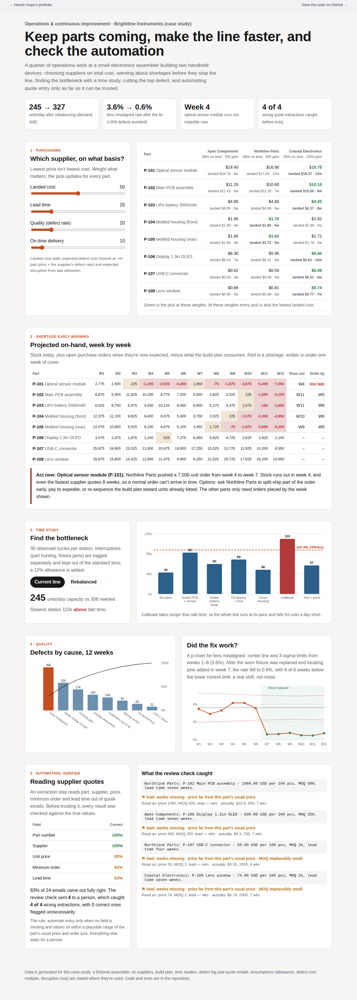

# Purchasing & Production Improvement

A quarter of operations work at a small electronics assembler, Brightline Instruments, which builds two handheld measurement devices on one line. The project covers purchasing, shortage planning, time studies and line balancing, defect reduction, and automating quote entry only as far as it can be trusted.

**Live:** linked from the [portfolio hub](https://harish04010-portfolio.vercel.app).



## Five problems, five results

| Area | What I did | Result |
|---|---|---|
| **Supplier selection** | Compared three suppliers for each of 8 parts on *landed* cost (price plus expected defect and late-delivery cost), lead time, defect rate and on-time delivery, with adjustable weights | Weighting cost picks the lowest landed cost everywhere. Weighting quality and speed switches to the premium supplier, and the page states the trade-off: a premium of about $340K a year buys 2.5 weeks shorter lead time and about 520 fewer defective parts. That's a decision to bring to the CEO, not to make silently. |
| **Shortage early warning** | Projected on-hand week by week from stock, open POs (at their *now-expected* dates) and the 12-week build plan, with order-by dates from the fastest supplier's lead time | **Optical sensor module runs out in week 4** because a supplier pushed a delivery from week 4 to week 7. No normal order can arrive in time, so it needs a split shipment, an expedite or a re-sequenced build plan. Five other parts get order-by weeks. |
| **Time study and line balance** | 30 timed cycles at each of 7 stations; interruptions logged separately and kept out of standard times; 12% allowance; compared against takt time | **Calibrate** (110s) is slower than takt time (88s at 308 units/day), so the line makes only 245/day. Moving the 28-second warm-up task to the previous station with a second fixture raises capacity to **327/day**. |
| **Defect reduction** | Pareto of 12 weeks of inspection results, then a p-chart with limits from the baseline weeks | **Lens misaligned** is the top defect. After the worn fixture was replaced in week 7, its rate fell from 3.6% to 0.6% (about 309 defects avoided), with most later weeks below the lower control limit: a real shift, not noise. |
| **Automating quote entry** | An extraction step reads part, supplier, price, MOQ and lead time from supplier emails; every result was checked against the true values; a review rule decides what a person sees | **83%** of 24 emails fully right. The rule flags missing fields and prices or MOQs far from the part's usual range, and caught **4 of 4** wrong extractions with 0 false alarms. The misses came from real-world formats: prices quoted per 100, MOQs written as "1k", and lead times spelled out. |

## Two things I got wrong first

- **Supplier scoring.** My first version scored each supplier as a ratio to the best ("cheapest price ÷ this price"). Defect rates differ 4× between suppliers while prices differ about 10%, so quality swamped cost even with cost weighted 75%. Each criterion is now scaled 0–1 within the part, so a weight means what it says.
- **The extraction check was too easy.** The first test set was all cleanly formatted emails, and extraction scored 100%, which proves nothing. Adding the awkward formats real inboxes contain dropped accuracy to 83%, and that's what made the review rule necessary, and testable.

## How it's built

- `ops/data.py` generates the operating data: suppliers and quotes, BOMs, build plan, stock, open POs, time-study observations, the defect log, and quote emails with their true values. It's seeded, so results are reproducible.
- `ops/analysis.py` holds the five analyses and writes `site/data.json`.
- `site/index.html` is the dashboard: supplier weights, the shortage heat map, the before/after line balance, the Pareto and p-chart, and the extraction audit.
- The extraction step is a rule-based parser so the project runs anywhere. The interface is the same if an LLM does the reading, and the accuracy check and review rule apply unchanged.

## Running it

```bash
pip install -r requirements.txt
python -m ops.analysis    # writes site/data.json
pytest -q
```

Assumptions are stated where they're used: a 12% time-study allowance, rework at about 4× part price, disruption cost from late deliveries, a 7.5-hour shift. The company and all data are fictional.
